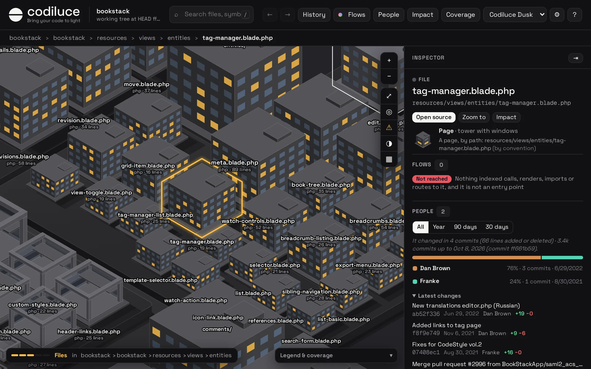
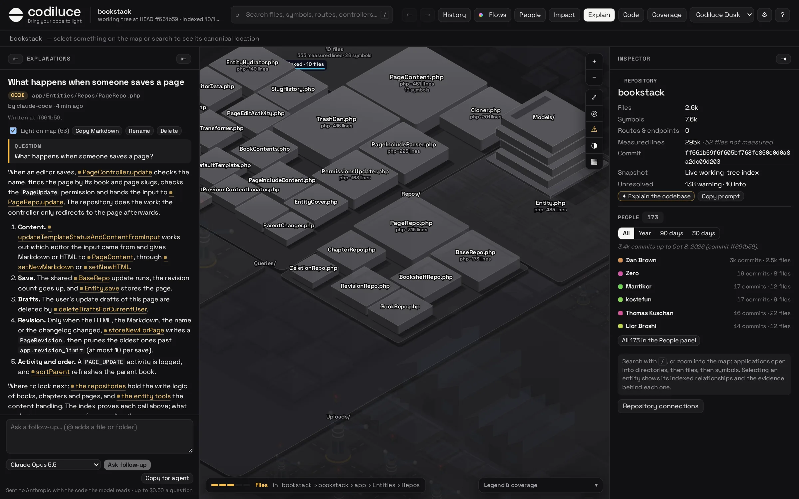
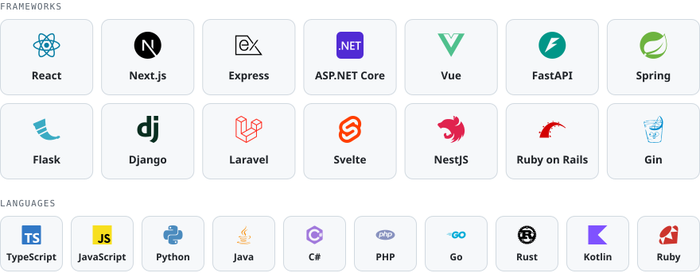

<p align="center">
  <a href="https://codiluce.com">
    <picture>
      <source media="(prefers-color-scheme: dark)" srcset="docs/brand/logo-on-dark.svg">
      
    </picture>
  </a>
</p>

<p align="center">
  <strong>Bring your code to light.</strong><br>
  See how your code fits together, even as agents keep changing it.
</p>

<p align="center">
  <a href="https://www.npmjs.com/package/codiluce"></a>
  <a href="LICENSE"></a>
  
</p>

<p align="center">
  <a href="https://codiluce.com">Website</a> ·
  <a href="https://codiluce.com/docs/">Docs</a> ·
  <a href="#contributing">Contributing</a>
</p>



## Why Codiluce?

<picture>
  <source media="(prefers-color-scheme: dark)" srcset="docs/readme/comprehension-gap-on-dark.svg">
  
</picture>

**The comprehension gap is widening.** More people and more agents are writing code, and every change is bigger than
the last. Reading the diff no longer tells a team what the system does, which flows a change touches, or what it can
break.

Codiluce keeps understanding in step with the code. It reads your repository and draws it as a map you can zoom,
search and replay, where every link between pages, requests, functions and tables comes with the evidence behind it.
Your agents explain the code on that map, and you see what each of them touches while it works.

## Quick start

Run it inside the repository you want to see:

```bash
npx codiluce@latest start .
```

Codiluce indexes the code, starts a local server and opens the map in your browser. You need Node.js 22.12 or newer.

The first time, it asks a few questions in the terminal, with real estimates: how much Git history to index (in the
background, while you use the map), which API keys to use for the optional language-model features, and which
coding agents to connect. Enter keeps the defaults; `codiluce setup` asks again. The analysis lives in `.codiluce/`,
which hides itself from Git.

Want it always at hand? Run `npm install --global codiluce`, then `codiluce start .` in any repository.

## Work with your agents

Codiluce is made for code that agents write. Connect Claude Code, Codex or Cursor once: they explain the code on your
map, and **Agents** shows you what every session is touching while it works.

### Ask your agent, read the answer on the map

Connect your agent to Codiluce's MCP server, from the repository:

```bash
claude mcp add codiluce -- npx -y codiluce mcp
```

`codiluce setup` does this for you when it finds Claude Code, Codex or Cursor. Then ask in your own words, for example
*"Use Codiluce to explain how checkout works, and publish it."* Its tools read the index (flows, blast radius, history,
source), so the agent starts from what the code provably does instead of guessing from file names.

- **Watch it explain.** While the agent works, the map's **Explain** column shows a card with what it is explaining,
  your question and each tool it calls.
- **Every link checked.** `publish_explanation` checks that every file, symbol and flow the answer names exists, then
  saves it in the column. Point at a link and that code lights up on the map; click it to open it.
- **Never silently stale.** Each explanation is pinned to the commit it was written against and says when the code it
  links changes.
- **No agent at hand?** With an Anthropic or OpenAI key, ask in the column itself, with files and folders attached by `@`.



### Watch your agents work

Open **Agents** beside the map to follow every Claude Code and Codex session at once. Each read, edit and search
outlines the code it touched in that session's color, and fades after 30 seconds. When two sessions touch the same
file, both marks show. Click a path in the feed to reveal the file, even one added since the last analysis.

Agents report their activity through hooks. **Agents → Agent connections** in the map shows the configuration to merge
into `.claude/settings.local.json` or `.codex/hooks.json`, and the CLI prints it too:

```bash
npx codiluce activity hooks --agent claude-code   # or: --agent codex
```

Only what the hooks report is shown; Codiluce does not watch the file system or guess who changed what. It keeps paths,
searches, tool names and session titles, in memory, and never prompts, file contents or command output. More in
[Agents](https://codiluce.com/docs/agents/) and the [design notes](docs/design/agents.md).

### Search agent sessions

Open **Agents → Import / refresh history** to import available local Codex and Claude Code transcripts for
this repository. Search messages and titles, filter by agent or by a file/folder read, edited or added in a tool
call, and open the original discussion beside the map, or expand Agents for reading. Live sessions appear in the
same list, with a highlighted activity card, observed files and one replacing public progress or response line.
The three session filters share one row; Codex setup instructions are hidden in the reader. Recently observed sessions refresh every ten seconds
while Agents is open, without moving your reading position. Public live updates use a bounded transcript tail every
three seconds and do not require a full history import. Refresh imports new messages without duplicating earlier ones. Failed and
unconfirmed calls are labelled; scripts and dynamic paths are not assigned guessed file activity.
Session summaries stay cached when Agents closes. The first page also survives browser reloads, scoped to this
project's archive, while a background check retrieves changes. Unchanged lists reuse the cache; imports remain
incremental. Open the list directly with `#sessions=list`; older `#conversation=` links still work.
Running agents use a clockwise six-dot indicator beside the Agents menu label and current public update.

Live hook observations provide status and map activity; transcript imports save messages and tool outputs
locally in `<state>/conversations.db`. System instructions and reasoning are excluded; tool outputs over
100,000 characters are shortened and labelled. Provider retention and transcript-format changes can affect what
is available. Rebuilding the code index does not erase imported history.

## What you can do

- **Ask, and read the answer on the map.** Explanations from your agent, or from the chat in the map, link the code
  they talk about: every link lights its code, and stale answers say what changed.
- **Watch your agents work.** Every file a Claude Code or Codex session reads, edits or searches lights up in its color,
  as it happens.
- **Zoom from the whole repository to a single line.** Applications, folders, files and symbols nest inside each other,
  sized by their code, each file drawn as the shape of its kind.
- **Follow a flow end to end.** From a page or a command, through the request, to the handler and the tables it reads
  and writes.
- **Replay your Git history.** Every commit becomes a snapshot. Compare any two, or watch the architecture change as a
  time-lapse.
- **See the blast radius.** Pick anything, or your uncommitted changes, and see what depends on it, hop by hop.
- **Review pull requests on the map.** Open and merged pull requests, and branches not merged yet, light the files they
  change, with their commits, people and blast radius.
- **Color the map by what matters.** Flow coverage, who changed the code most, complexity, recent changes or hotspots.
- **Check the evidence.** Every link opens the file and line that proves it. What cannot be proven shows up as a
  finding, never as a guess.
- **Add descriptions, if you like.** A language model can describe files, flows and commits, with the cost estimated
  and capped first.

## Hide paths from the map

Select a file or folder and choose **Hide from map** in the Inspector, or right-click it on the map.
The map reclaims its space while its source, search results and connections stay indexed. Use the
**Hidden paths** button in the toolbar to restore paths, or **Undo** to reverse the last change.
Hidden search results offer **Reveal on map**, which shows that path without restoring its whole folder.

Local choices are saved in `.codiluce/map-visibility.json` (or your configured state directory).
For shared defaults, commit a `.codiluceignore` file at the repository root with Git-style patterns:

```gitignore
# Hide the root documentation folder from the map
/docs/
# Hide example folders anywhere
examples/
```

Restoring a shared rule in the UI saves a local override and leaves `.codiluceignore` unchanged.
These rules apply to the live map, history comparisons and playback. The existing `ignore` setting
in `.codiluce/config.yml` separately excludes files from analysis.

## Private by design

Codiluce runs on your machine. It reads your code but never runs it, never installs its dependencies and never writes
to your checkout. Nothing leaves your computer unless you ask for AI descriptions, ask a question in the map's chat or
ask for GitHub pull request data. Your agent reads the index through Codiluce's MCP server, and reports its activity
through hooks, both on your machine.

## Languages and frameworks

<picture>
  <source media="(prefers-color-scheme: dark)" srcset="docs/readme/stacks-on-dark.svg">
  
</picture>

How far Codiluce follows the code depends on the stack:

- **Flows to the data:** React and Next.js with Laravel and Inertia, from the click through the request to the
  handler and the tables it reads and writes.
- **Routes and handlers:** Express, NestJS, Vue Router, Nuxt, SvelteKit and Astro; Django, FastAPI and Flask; Spring
  MVC and WebFlux; ASP.NET Core; Ruby on Rails; Gin, Echo, Fiber, Chi, Gorilla Mux and net/http; Axum, Actix Web,
  Rocket and Warp. Every route links to the exact handler that serves it.
- **Structure and binding:** TypeScript, JavaScript, Laravel PHP, Python, Go, Ruby, Java, Kotlin, C# and Rust get
  declarations and bounded imports, references and direct calls.
- **General PHP structure:** original classes, interfaces, traits, enums, functions, members, property promotions/hooks
  and named closure bindings outside Laravel. Namespace/import/load syntax and anonymous/inline regions retain exact
  source positions; Composer/load resolution, references and runtime behavior remain follow-on work.
- **C/C++ structure:** original declarations, prototypes, definitions, types, fields, namespaces and macros, with
  source ranges and preprocessor context. Includes and type binding remain visible gaps.
- **Objective-C structure:** original interfaces, implementations, categories, protocols, properties, ivars and signed
  selectors, standard enum/options source profiles, native C++ declarations and C++-typed selector headers.
  Original-source recovery preserves positions and context gaps. Mixed files and SDK macros remain partial; imports,
  shared types, message dispatch and compiler-generated accessors remain open.
- **Swift structure:** original types, protocols, extensions, functions, argument labels, properties, enum cases,
  initializers, subscripts and operators with exact source ranges. Imports and macros retain source syntax;
  cross-file binding and generated declarations remain visible gaps.
- **Scala structure:** original Scala 2/3 packages, classes, traits, objects, methods, properties, enums, givens,
  aliases and extension receiver headers with exact source ranges. Imports, implicit/type binding and compiler
  synthesis remain visible gaps.
- **Groovy structure:** original types, traits, records/components, methods, constructors, properties/fields and
  script bindings. Imports and annotations retain source syntax; unsupported grammar, generation and DSL binding
  remain visible gaps. Gradle and Jenkins sources are read without execution.
- **F# and VB.NET structure:** original source declarations with exact ranges and explicit parser gaps.
  F# includes dedicated signature files; VB.NET preserves original source headers without project/compiler binding.
- **ERB templates:** original server Ruby regions and declarations, literal HTML script/style regions and named
  literal JavaScript declarations, with one original template identity. Rendering, interpolated scripts and Rails
  template lookup remain visible gaps.
- **Razor templates:** original component/view identity, C# member and render-local declarations, source directives
  and literal JavaScript/script/style regions. Compiler output, partial code-behind, imports and navigation stay open.
- **Liquid templates:** original tags, controls, raw/comment/body regions and qualified literal JavaScript source,
  plus explicit quoted Shopify template dependencies within one indexed theme. Dynamic/app-block/section-group lookup,
  arbitrary engines, rendered output and runtime binding remain visible gaps.
- **Map:** Angular, Remix, Fastify, Symfony, Quarkus, Blazor and every other language and framework are detected and
  mapped with their files, lines and Git metrics.

Everything above ships in the npm release (0.3.0). Support deepens with every release: see how far each framework
goes, and what stays a visible gap, in [Languages & frameworks](https://codiluce.com/docs/stacks/). Missing your
stack? [Open an issue](https://github.com/codiluce/codiluce/issues) with a public repository that shows it.

<sub>Logos are trademarks of their owners, shown only to say which code Codiluce reads. Artwork from
[Simple Icons](https://simpleicons.org) (CC0) and [Devicon](https://devicon.dev) (MIT).</sub>

<details>
<summary>Analysis notes by language, for contributors</summary>

TypeScript and JavaScript are analyzed down to calls and requests across applications and local workspace packages, and supported frameworks down to
routes, commands and tables. Express and Nest have static routing packs for mounted routers and registered controllers,
with handler links and visible gaps. Python, Go, Ruby, Rust, Java, C# and Kotlin also have declaration maps, with source ranges
and nested types/functions. C/C++ add original declaration maps, prototype/definition distinctions, complex declarators,
fields, typedefs, namespace/type ownership and original preprocessor syntax. C/C++ imports, references and translation-unit
binding are not implemented. Python also resolves static imports across packages, namespace portions and configured or
manifest source roots, binds local/imported calls and bounded re-exports, and has initial FastAPI, Flask and Django packs for
registered routes, routers/blueprints, URL includes/namespaces, invoked or configured entrypoints, exact function/class view handlers and framework references. Conditional/type-only bindings and dynamic
registration retain visible gaps. The inspector shows which analysis features are available for each file. Other ecosystems
are detected and mapped with their files, lines and Git metrics. Missing
yours? [Tell us](https://github.com/codiluce/codiluce/issues).

Swift now has an initial source-only structural adapter with pinned upstream WASM, lexical ownership,
label-aware overload identities, original attributes/conditional context and bounded parser recovery. No Swift
compiler, SDK, SwiftPM manifest or target code executes. Imports/references/frameworks remain unsupported;
macro/property-wrapper expansion and conditional grammar recovery stay explicit. Twenty conformance cases,
installed-package/history checks and an [immutable two-file source audit](docs/swift-source-accuracy.html) qualify
this initial subset. Broader Swift source accuracy and native OS checks remain P10 release gates.

Scala now has an initial source-only structural adapter for Scala 2/3 syntax, including Scala 3.6 conditional
given headers, package context, explicit companion declarations and extension receiver signatures. No Scala
compiler, JVM, sbt/Scala CLI, build scripts or target dependencies execute. Anonymous owners, derives and staged
expansion retain explicit gaps. Twenty-eight conformance cases, installed-package/history checks and an
[immutable Scala 2/3 source audit](docs/scala-source-accuracy.html) qualify the initial subset; broader source
accuracy and native OS checks remain P10 release gates.

Groovy now has an initial source-only structural adapter with a reproducibly built, pinned community grammar.
Twenty-nine conformance cases and an [immutable five-file source audit](docs/groovy-source-accuracy.html) cover
library/build logic, Gradle and Jenkins sources. The audit retains 13 of 23 reviewed declarations; ten members of
a builder with annotated parameters are omitted with an explicit ownership gap. Nested types, Unicode names and
some command-style named arguments remain unqualified. No JVM, Groovy compiler, AST transform, Grape download,
Gradle/Jenkins or target code executes. Imports, references and framework semantics remain unsupported.

ERB now has an initial original-region adapter with pinned native template/Ruby/HTML parsing. It processes tags
before HTML, preserves UTF-16 source ranges and original declarations spanning blocks, and parses qualified literal
inline JavaScript without execution or emit. Unknown engine/trim modes, recovery, rendered interpolation and external
scripts remain explicit gaps. The [immutable ERB source audit](docs/erb-source-accuracy.html) qualifies reviewed original
region boundaries; named Ruby/JavaScript declarations are additionally covered by conformance and installed-package
checks. Import/reference/framework binding remains open.

Razor now preserves native original component/view regions and C# members, render-local functions and qualified literal
JavaScript. It uses a reproducible pinned generated-C grammar build with original MIT notices and twenty verified
local WASM assets. The [immutable Microsoft source audit](docs/razor-source-accuracy.html) qualifies 13 declarations
and 28 of 29 reviewed source regions; valid route-less `@page`, HTML doctype and some literal text cause visible grammar
gaps. Runtime/component compilation, code-behind, imports, Razor Pages/Blazor routing remain open.

Liquid now has a pinned native original-region adapter and one canonical template identity. It retains original UTF-16
ranges, variable binder metadata and complete independent Shopify JavaScript bodies, without generating render helpers
or virtual files. The [immutable Dawn source audit](docs/liquid-source-accuracy.html) qualifies 12 original JavaScript
declarations, 42 reviewed template dependency sites and 1,626 original delimiter regions across ten files. Explicit quoted
render/include/section/layout dependencies resolve only to eligible original files within the indexed/configured
`shopify-theme` application. Recovery, app blocks, section groups, generic/Jekyll engine lookup, non-HTML asset processors,
interpolated/control-dependent scripts, rendered output, reference/framework/effect binding and broader accuracy remain open.

General PHP now uses the existing `php-parser` provider with an explicit PHP 8.4 source profile in a cancellable,
memory-bounded parse-only child process. It reads indexed unchanged files, including files outside configured
applications, and retains original declarations without invoking PHP, Composer, autoloaders or target code.
The [immutable Symfony source audit](docs/php-source-accuracy.html) qualifies 30 reviewed declarations across six
original files, with exact source/header/name ranges, qualified names, owners and cold/warm/revision agreement.
Per-file outcomes distinguish supported structures, anonymous-source gaps and parser failures; generic imports,
references, frameworks, effects and guards remain unsupported. Existing Laravel IDs and semantics retain their separate
provider; broader Laravel structure integration and PHP indexed imports/scoped binding are the next subphases.

Java and Kotlin now resolve original local import declarations within selected Maven reactors, literal Gradle projects
and recorded source/classpath inputs. Explicit, wildcard, static and alias imports retain source evidence and visibility
constraints. Unknown build configuration, excluded sources, binary classpaths and competing declarations stay visible.
Scoped Java/Kotlin references now bind original types and exact signatures for direct static/private/final/concrete calls,
with separate original lambda ownership. Virtual/inherited/generic dispatch, generated constructors and injection retain gaps.
The initial Spring MVC pack supports selected Spring 6.2/7.0 and Boot 3.5/4.0 profiles, resolved controller/mapping annotations,
class/method path arrays, original constant paths, recorded or entry-configuration component scans, direct original handlers,
literal servlet prefixes and bounded PathPattern matching. Parameter restrictions and HTTP HEAD/OPTIONS remain distinct;
unknown headers, negotiation, profiles, custom configuration and registrations stay constrained. Plain Spring is detected
alongside Boot. The initial WebFlux.fn pack adds Java builder chains, Kotlin `router`/`coRouter`, nested/composed routes,
original functional handlers and first-match dispatch under selected reactive profiles and bean registrations.
`jvm.spring.stack: webflux` with `componentScan` or `routers` records a deployment selection; `entrypoints.spring` can
select original Boot or Configuration/EnableWebFlux roots. Unknown predicates, filters, bean ordering and custom
configuration remain visible candidates. No target JVM compiler, build, dependency, plugin or application runs.
C# now resolves original namespace, static, alias and global using directives within indexed SDK/MSBuild compile items,
linked source files and local project references. Literal props/targets imports, recorded target/configuration selections
and original XML `Using` items retain source evidence. Compatible partial types combine member lookup while retaining every
original fragment and compilation identity. Scoped references, exact overloads, direct nonvirtual/concrete calls, original
lambdas, local functions and top-level bodies now retain source proof and call coverage. Overlapping compilations,
conflicting partial declarations, conditional preprocessing, denied sources and executable build behavior remain explicit. `applications[].dotnet` records the selected
project and compilation inputs; `sourceRoots.csharp` can define a compilation when no project is available.
Inherited/generic/dynamic dispatch, conversions, generated constructors, accessors and compiler delegate/task behavior
retain explicit gaps. ASP.NET Core 8–10 now adds serving-reachable minimal hosting, nested route groups, invoked original
source helpers/factories, method groups and natural delegates. Original Web SDK/TFM/framework-reference inputs select a
reviewed family; SDK implicit namespaces require original `ImplicitUsings` selection. `entrypoints.aspnet` can select an
original startup method, and `dotnet.aspnet` records a runtime `version` or external deployment `pathBase`.
Route contracts retain optional/default/catch-all/complex segments, reviewed constraints, order, hosts and explicit methods.
GET does not imply HEAD. Authorization, filters, middleware, custom binding/metadata, changed/escaped hosting values and
conditional startup retain gaps. MVC now adds serving-reachable controller registration through original AddControllers,
AddControllersWithViews/AddMvc and MapControllers/MapControllerRoute/MapDefaultControllerRoute/MapAreaControllerRoute calls.
Original public controller/action discovery, compatible partial fragments, bounded source inheritance, attribute selectors,
controller/action/area tokens, ActionName/Async naming, literal route defaults and native conventional order retain original
handler IDs and source proof. Custom application parts, model/parameter/result metadata, filters, activation and executable
MVC options remain candidates. P8e1 adds eleven mixed Java/Kotlin/Spring/ASP.NET profiles, original frontend-to-handler/source-leaf projections, cache invalidation checks and eight pinned upstream source scans. Local Linux performance passes the cold-time/RSS comparison against P8d2. Native Windows/macOS and broad production recall remain P8e2/P10 gates. See the [source portfolio](docs/jvm-dotnet-source-qualification.html) and [performance report](docs/jvm-dotnet-compatibility-performance.html). No target .NET/MSBuild toolchain runs.

Rust now resolves original Cargo packages/workspaces, separate library/binary/example/test/bench targets, declared local
path dependencies and renamed crates. Inline/out-of-line modules, native filename and `#[path]` rules, scoped grouped/aliased
imports, source globs, re-exports, namespaces and privacy retain original declaration IDs and ranges. Both `rust.features`
and `rust.defaultFeatures` record a closed feature selection; `rust.cfg` records a complete flag/value set, and
`rust.targetTriple` selects literal Cargo target tables without inferring host cfg. `rust.package` selects an original
manifest relative to the application, `rust.target` selects its kind/name, and `rust.includeTests` includes integration
tests/benches. Unselected conditions stay uncertain. Registry/Git crates retain external identities; binary exports,
build scripts, source overrides, proc macros, generated items, resolver 1 feature unification and unreviewed effective
configuration retain gaps. P9a import support has conformance, installed CLI/API and [pinned source checks](docs/rust-source-qualification.html).
Rust now adds compilation-scoped references and direct source function/inherent-method calls, immutable callback aliases,
original closure/async-block ownership and bounded source callback-return summaries. Original paths, caller/target IDs and
proof remain visible through the CLI/API and warm/history replay. Trait/generic dispatch, arbitrary receiver coercion,
mutable callbacks and compiler/borrow inference retain gaps.
P9c now adds initial Axum 0.7/0.8 and Actix Web 4 packs under original registry/version/feature identities. Selected bin
entries follow bounded source factories/helpers, source closures, consuming builders and awaited server futures.
Axum route/method routers, nest/merge, fallback, HEAD and layer order retain native raw-path and path-before-method rules.
Actix App/scope/resource/service/configure, literal HTTP service attributes, empty resource paths and inherited defaults
retain ordered resource/route guards and selective percent decoding. Original endpoints, callbacks, handler leaves,
Cargo/mount/serving proof and request flows survive installed CLI/API and cache/history replay. Wide backend defaults
require an application boundary before competing with frontend requests. Unreviewed versions, macros, custom regexes,
guards, middleware, conditional setup and generic/native trait inference retain gaps. Literal log 0.4 messages and the
default Actix Logger have narrow reviewed contracts. See the [unchanged Actix source profiles](docs/rust-router-source-qualification.html).
P9d1 adds initial Rocket 0.5 attributes, literal `routes!` source lists, macro imports, mount prefixes and selected
launch/main entrypoints. Original factories and handlers retain native default/manual ranks, HEAD fallback, decoded
segments, literal queries and fixed-width integer/bool/string parameter guards. Unknown request/body/query guards,
fairings, catchers and conversion/compiler contracts retain conditions. P9d2 adds initial Warp 0.3/0.4 raw
path/method filters, typed captures, literal/type `path!` syntax, prefix composition and original map/then/and_then
handlers. Full filter trees preserve ordered rejection and cursor reset; separate native bind/run contracts require
awaited serving. Unknown extraction, fallible handler success, recovery/wrappers and compiler/Reply inference keep
gaps. P9e1 adds mixed-stack conformance for all six Rust version profiles with TS/Vue/Svelte/Astro requests,
shared original Cargo source, concurrent recorded Unix/Windows contexts, native default responses, source proof,
cache/history replay and invalidation. Repeated identical registration proof is deduplicated; a 192-route and
768-request source portfolio fits a 16 MiB graph serialization budget. The [local performance comparison](docs/rust-compatibility-performance.html)
records unchanged frontend controls and the cost of adding native Rust routing against P9b. P9e2a adds
[unchanged Axum source accuracy](docs/axum-source-accuracy.html): ten original 0.8 profiles match 55 reviewed
functions and 31 route/handler pairs, with two additional macro/custom-extractor boundary profiles. Standard startup
diagnostics preserve native listener identity and original lexical scope; trailing comments preserve router factory
returns. Unreviewed listener versions, nested macro effects and custom handler extractors retain request uncertainty.
P9e2b1 adds [runtime namespace qualification](docs/rust-runtime-namespace-accuracy.html): all three reviewed general
Rust module imports now resolve, while the same declarations, routes and original handler identities remain exact.
Canonical Tokio 1, Actix Web 4 and Rocket 0.5 main attributes preserve sibling source namespaces under bounded
version/feature/syntax contracts; annotated signatures and generated bodies remain opaque to general binding.
Unknown generation, source/fork identities, composed wrappers and unavailable macro imports retain gaps.
P9e2b2a adds [unchanged Rust consumer accuracy](docs/rust-consumer-source-accuracy.html): the Rocket 0.5 sample now
retains all four original handlers, with three qualified routes and a conditional custom form query. A Warp 0.3
all-method control and a legacy Rocket boundary retain their original contracts. Qualified Rust prefixes, direct
values and framework macros use separate namespaces. Bounded canonical Rocket form derives preserve sibling source
namespaces; original generated traits and query conversion remain opaque. Broader Axum 0.7/Warp 0.4 and consumer
import/version accuracy remain P9e2b2b, and native OS release checks remain P10.
P9e2b2b1 adds a [broader original-consumer audit](docs/rust-broader-consumer-accuracy.html) for two Axum 0.7 and
two Warp 0.4 applications. It inventories all 29 user routes and 14 source module declarations, retaining misses
and conditional/unbound handlers. Empty canonical Rust print macros now preserve reviewed namespaces and diagnostic
syntax. The broader accuracy gate remains open; custom derives, state filters, middleware and serving delegation
remain follow-on work.
P9e2b2b2a adds [recorded derive namespace qualification](docs/rust-derive-source-accuracy.html). Canonical builtin
derives and four reviewed Serde provider versions preserve sibling source namespaces through original Cargo.lock
dependency selections. The unchanged Warp Q&A consumer now binds all five original callbacks conditionally, bringing
the full inventory to four qualified pairs, 14 conditional bindings and 11 misses. Generated traits, JSON/form
conversion, state filters, middleware and serving delegation retain gaps. Missing or unreviewed provider selections
and builtin-looking macro shadows cannot lend a namespace proof.
P9e2b2b2b adds [Warp extraction and serving qualification](docs/warp-extraction-source-accuracy.html). Earlier
map/then/and_then callbacks become deferred extraction references when a later mapper consumes them; the final
response callback retains handler ownership. Query/JSON/form filters preserve one ordered argument slot, with
deserialization and predicates still unreviewed. Bounded callback captures and native boxed Clone behavior are
checked, and awaited source helpers accept literal IPv4/IPv6 socket addresses. All five original Q&A state
callbacks retain source coordinates, while custom state types, CORS/recovery and generated traits keep conditions.
The full 29-route consumer denominator remains four qualified pairs, 14 conditional bindings and 11 misses.
Wrapper/serving delegation and Axum helper/middleware qualification remain next.
P9e2b2b2c1 adds [Warp wrapper and serving delegation qualification](docs/warp-wrapper-source-accuracy.html).
Recorded tracing-attributes 0.1.31 / tracing 0.1.44 allow parameter-free original serving helpers to be projected
with generated span/subscriber behavior left conditional. Native default Warp log/trace wrappers preserve original
handlers and rejection shape. Recorded Tokio test macros exclude test functions from the ordinary bin context;
literal include_str supplies namespace proof without reading included contents. All five original placey callbacks
now bind conditionally. The full portfolio has four qualified pairs, 19 conditional bindings and six misses.
Custom state, CORS/recovery and Axum helper/middleware work remain open, along with broader P9/P10 qualification.
P9e2b2b2c2 adds [Warp custom state, CORS and recovery qualification](docs/warp-cors-recovery-source-accuracy.html).
Original state types now retain their owning compilation and deferred source references. Native CORS builders
preserve source settings and model preflight bypass; native recovery resets the rejection cursor and retains a
separate deferred callback reference. Neither bypass nor recovery borrows an original route handler's path proof.
All five unchanged Q&A handlers retain their original state, Store type and recovery references. The full portfolio
remains four qualified pairs, 19 conditional bindings and six misses. Generated traits, field bounds, header inputs
and recovery outcomes stay conditional. Axum helpers/middleware and broader P9/P10 qualification remain open.
P9e2b2b2c3 adds [Axum helper and middleware qualification](docs/axum-helper-middleware-source-accuracy.html).
Axum 0.7/0.8 consumers can retain original functions conditionally when unrelated type attributes leave generated
exports unreviewed. Original helper merge/nest/state summaries now retain all six course handlers. Four native
middleware constructors preserve deferred original callbacks, state mode, operation coordinates and layer order.
Response mapping retains request-part extraction before the inner service and possible rejection. Canonical bounded
formatting has namespace proof with runtime effects left conditional. The full portfolio now has four qualified
pairs, 25 conditional bindings and zero source route misses; general Rust binding stays conservative. Custom
middleware/state/extractor contracts, wider source/version coverage, broader P9/P10 and native-platform gates remain open.
No Cargo/rustc or target code runs.

Vue, Svelte and Astro now expose embedded JavaScript/TypeScript declarations, imports, calls and requests at their original
component source locations. Module and instance scopes stay distinct; Astro server and client scripts retain separate contexts.
Vue 3 also links local template components and bounded event callbacks. Vue Router 4/5 manual route records resolve
nested paths, named views, literal lazy imports, aliases and redirects after a proven app installation. Original event
sites enter the existing flow inspector and browser proxy matching. Unsupported dynamic/plugin behavior stays visible.
Svelte 4/5 links parsed local components, scoped snippets and legacy or modern browser callbacks. SvelteKit 2/3 adds
filesystem pages/layouts, loads, HTTP handlers and named POST actions, with static configuration and distinct execution
contexts. RequestEvent fetch and shared registrations keep the invoking application's ownership. Dynamic hooks/matchers
and unsupported syntax retain gaps. Astro 5/6/7 now links original components/layouts, pages, method exports,
static build operations and qualified Vue/Svelte/React islands. Prerendered files stay separate from live APIs;
dynamic configuration, middleware policies and generated URLs retain gaps. Bounded Nuxt conventions are next.

</details>

## Learn more

- [Getting started](https://codiluce.com/docs/), [languages & frameworks](https://codiluce.com/docs/stacks/),
  [using the map](https://codiluce.com/docs/map/), [explanations](https://codiluce.com/docs/explanations/) and
  [agents](https://codiluce.com/docs/agents/)
- [History](https://codiluce.com/docs/history/), [CLI & API](https://codiluce.com/docs/cli/) and
  [configuration](https://codiluce.com/docs/configuration/)
- [How it works](https://codiluce.com/docs/how-it-works/), the [technical reference](docs/reference.md) and the
  [architecture](docs/architecture-visualizer.md)

## Contributing

Codiluce is young and shaped by the teams who use it, so feedback counts as much as code.

- **Tell us what your team needs.** [Book a 30-minute call](https://calendly.com/mikeltorresugarte-ynlf/30min).
- **Report what it gets wrong.** [Open an issue](https://github.com/codiluce/codiluce/issues);
  `npx codiluce inspect diagnostics` is a good place to start. Remove private paths first.
- **Send code.** [CONTRIBUTING.md](CONTRIBUTING.md) explains how to run Codiluce from source and test it.

## License

[MIT](LICENSE)
