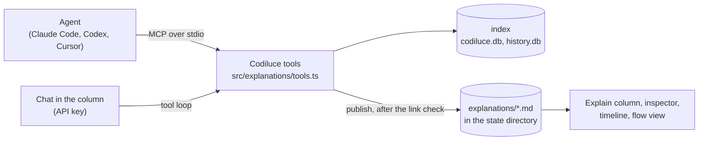

# Explanations

Language models explain the code, and the answer is read on the map. Proposed and built 2026-10-14 on the
`explanations` branch. This doc records the design, the decisions taken while building it, and the ideas left for
later.

## What it is

An explanation is a Markdown text whose links name code: files, folders, symbols, flows, tables, commits, pull
requests and features. It comes from one of two places:

- **An agent** the user already works with (Claude Code, Codex, Cursor), connected to Codiluce over MCP. Its tools read
  the index, and `publish_explanation` saves the answer.
- **The chat in the map**, when an Anthropic or OpenAI key is set. It uses the same tools and saves the same way.

Explanations live in the **Explain** column, beside the map. Pointing at a link lights what it names. Clicking opens
it: a file or symbol in the Code panel, a flow in the middle, a commit on the timeline. An explanation is pinned to
the commit it was written against, and says when the code it links changes.

## Why "Explanations"

Other names were considered:

- **Intelligence** names where the text comes from, not what the reader gets. It also suggests the model *knows*,
  while the product keeps facts (the index) apart from generated text.
- **Conversation** fits the chat, but not a text an agent saves.
- **Annotations** is already the name of `annotate` (descriptions of every file, folder, flow and commit).

*Explanations* matches the request ("I want to understand X"), and keeps descriptions and explanations apart:
descriptions cover everything in a batch, and explanations answer one question when asked.

## Shape

- **One tool layer, two clients.** `codeTools` (read-only: `overview`, `search`, `entity`, `relations`, `flows`, `flow`,
  `impact`, `history`, `commit`, `source`, `check_links`) serve both the MCP server and the chat. `explanationTools`
  (`publish_explanation`, `update_explanation`, `list_explanations`, `read_explanation`) are for agents; the chat saves
  its answer itself.
- **One store.** `<state>/explanations/<id>.md`: YAML front matter, then turns after `<!-- codiluce:question -->` and
  `<!-- codiluce:answer … -->` markers. It is readable and diffable, works without SQLite locking between `serve` and
  `codiluce mcp`, and a hand-written Markdown file is read as one answer.
- **Services.** `ExplanationService` (`src/explanations/service.ts`) lists them with their staleness, resolves one,
  answers the reverse index and publishes. `ChatService` (`chat.ts`) runs the chat. `routes.ts` serves both over
  HTTP.

## Links

Models know paths, not index IDs, so links are repository-relative paths, with a few schemes for what is not a file:

| Link | Names | Lights |
|---|---|---|
| `app/Http/Kernel.php` | a file | the file |
| `app/Http/` | a folder | its files (at most 2000) |
| `File.php#Class.method`, `File.php#name` | a symbol (also `::`, `->`, a qualified-name end) | the symbol |
| `File.php#L40-L62` | lines | the innermost symbol at the first line, else the file |
| `flow:POST /api/orders`, `flow:/cart` | a flow by its entry point (a route without its method when only one matches) | everything the flow touches |
| `table:orders` | a table declared by migrations | the table |
| `commit:3fe7e5b`, `pr:42` | a commit; a merged PR from its merge or squash message | nothing (opens the timeline) |
| `feature:billing` | a feature (the `annotate` domains) | its files |

`resolve.ts` resolves them against the live index (`ProjectionService.linkContext()`). A path written relative to
an application resolves when exactly one indexed path ends with it, with a note to write the full path. Code
blocks and code spans are never links. Every tool result carries the `link` to copy, so models rarely need to build
one.

**The index checks the text.** `publish_explanation` refuses text whose links resolve to nothing, and returns each
one with its reason (`No symbol nothingHere is indexed in …`, `… matches 3 paths; give the full path`). The chat
sends an answer with unresolved links back once to be fixed. The sentences themselves are not checked, and the UI
marks the text as generated.

## Pinned to a commit

Publishing records the indexed commit (and whether the tree had uncommitted changes), and a fingerprint of every
linked target:

- a file: its content hash
- a symbol: its declaration body hash (it survives moves and whitespace)
- a table: its shape
- a folder or a flow: a hash of its files' hashes

Each later reading compares the fingerprints with the current index. A changed fingerprint makes the link `changed`
(dashed in the text); a target that no longer resolves makes it `missing` (struck through, with the reason). The
explanation then says *"3 of 12 linked items changed since this was written at abc1234 · 4 commits since"*, counted
on the first-parent history, with **Refresh** (the chat rewrites it from what changed) and **Copy refresh prompt**
(for an agent: `read_explanation`, then `update_explanation` with `mode: "replace"`). A refresh keeps the first
question and replaces the answers.

## Where explanations show

- **The column** (`web/components/ExplanationsPanel.tsx`): a dedicated column between the left panel and the map,
  resizable. It holds the history, the reader (questions, answers, *Linked code*, staleness), and the composer.
  `#explain=<id>` opens one.
- **The footprint lens.** While an explanation is open, *Light on map* lights everything it links and the rest
  recedes. It reuses the feature and person lens (`FamilyOverlay`) and wins over them.
- **Hover.** Pointing at a link (or focusing it) lights only what it names, outlines it, and hides the selection's
  connection lines. The camera never moves: a moving map would make a paragraph with eight links unreadable. Code
  off screen gets an arrow at the map's edge. Clicking selects, flies and opens.
- **The reverse index.** The inspector's *Explained in* lists the explanations that link the selection or something
  inside it, or that link a folder holding it, with *changed since* when they are stale.
- **Subject anchors.** Each explanation records what it is about: `overview`, `flow`, `commit`, `pr`, `entity` or
  `question`. Explanations about a commit or PR mark it on the timeline and show as a chip in its header. Those about
  a flow show in the flow view's header, and those about an entity show at the top of its inspector.
- **Questions where the code is.** *✦ Explain* in the inspector, on a flow and on a commit, with more questions behind
  `⋯`: *What would break if I changed it?* (impact), and, for a file no flow reaches, *Why does no flow reach it?*
  Each one opens the question in the composer, or *Copy prompt* copies it for an agent, with the command that
  connects Codiluce if it is not connected yet. *+ Add to question* attaches the selection.
- **Templates.** The questions people ask most, with `[placeholders]` to fill, in four groups: *Understand* (the
  codebase, getting started on an area, a file or folder, how a feature works, where something happens, a table),
  *Dependencies* (of a part, third-party packages, architecture and boundaries, how two parts connect), *Change*
  (what would break, planning a change, recent changes, tests) and *Risks* (security review, possible bugs, tracking
  down a bug, unused code, performance). They live in `src/explanations/templates.ts` and show in three places:
  - the composer: while the box is empty, *Templates* is its primary button and four templates sit above it as
    tiles. *Templates* (or `/` typed in the empty box) opens a dialog with a search, the four categories and a card
    per template: an isometric icon drawn like the map (a plate, blocks, the subject in the accent color, a sign
    such as a shield or a bug; `web/components/TemplateIcon.tsx`), what it answers, and its placeholders. Choosing
    one fills the box with its first placeholder selected, so typing replaces it; Tab and Shift+Tab move between
    them, `@` fills one with code from the index (its name in the sentence, its link attached), and *Ask* waits
    until none is left. One attached chip fills the code placeholder. *Copy for agent* sends the template's own
    tool hints.
  - the inspector's `⋯` (with their icons), for the templates that suit the selection (a file, folder, symbol, flow or table), risks
    first: *Review it for security issues*, *Look for bugs in it*, *How well is it tested?*… The selection fills
    the code placeholder.
  - MCP prompts (`explain-security`, `explain-bugs`, `explain-debug`…), one required argument per placeholder (`path`
    for the code one), next to the six prompts above; the three those already ask are not listed twice.

## The chat

- **Providers.** Claude Opus 5.5 (the default with an Anthropic key), Sonnet 5.5 and Haiku 5.5 use the official
  Anthropic SDK. The loop is a streamed manual tool loop: tools with eager input streaming, a cached prefix,
  `effort: medium`, and server-side refusal fallbacks (`fallbacks: "default"`) on Opus and Sonnet. GPT-6.1 Sol and
  GPT-6 Luna use the Responses API with function tools, as `annotate` already does.
- **Keys** come from the environment or a `.env` of the tool workspace or the state directory, never the target
  repository. They are read again on each question, so adding one needs no restart.
- **Cost.** Each question is capped (default $0.50, `CODILUCE_CHAT_MAX_COST`). Close to the cap, or after 14 tool
  rounds, the next request disables tools and asks the model to answer. Each answer records its cost.
- **Follow-ups** send the earlier turns as text in a new request instead of replaying the model's own turns. This works
  the same with both providers, and it avoids replaying thinking blocks across requests.
- **Privacy.** The composer says what leaves the machine: the question, the attached links, and what the tools return
  (source excerpts among them). `serve --read-only` refuses asking, renaming and deleting.

## Decisions taken while building

- **Dedicated column**, not a left-panel tab. Text sits on the left, the lit map in the middle and the code on the
  right, so all three are visible while reading.
- **Markdown files in the state directory.** They stay private by default, like the rest of `.codiluce/`. Sharing
  them with the team (committing them, or exporting them to `docs/`) is a later step.
- **MCP over stdio only.** It works in every client, and it does not need the map to be running. `serve` writes
  `<state>/serve.json` with its address, so a published explanation can link to the open map. An HTTP transport
  could come later, for a live `show` tool (below).
- **Lenient reading, strict publishing.** The reader renders any Markdown and marks what does not resolve; publishing
  refuses unresolved links unless `allowUnresolved` is passed.
- **No raw HTML.** The column's Markdown reader (`web/lib/markdown.ts`) builds React elements, never HTML, so model
  output cannot inject markup.

## Later

These ideas came up with the design and were left for later.

### PR walkthrough in reading order

For a pull request, the model orders the changed files for a reviewer (entry point first, then what it calls, then
data, then tests) instead of alphabetically. Each step says what changed and why, and the blast radius closes it
out. It needs the PR's net change set; that comes from the pull request work (branch `pull-requests`, unmerged), or
from `commit` on its merge commit today. It fits the agent-era problem directly: agents write PRs faster than people
review them.

### A live `show` tool

While the user talks to their agent in the terminal, the agent lights and selects code on the map that is open
("look: these four files are the problem"). It needs a channel from `codiluce mcp` to `serve`: an HTTP endpoint the
MCP process calls (with the request header, loopback only), or the MCP server living inside `serve` over the
streamable HTTP transport. The map would then take a `show` event the same way it takes a link hover.

### Tour playback

Designed and being built: see [explanation-tours.md](explanation-tours.md). The original idea:

Step through an explanation's links in order, with the camera flying from one to the next, the way a flow plays on
the map. A paragraph is one stop. *Follow* (the camera frames the links of the paragraph being read) is the light
version.

### Export to `docs/`

Write an explanation into the repository as Markdown, with its links kept as repository-relative paths (they already
work on GitHub), its commit noted, and its questions as quotes. *Copy Markdown* does the in-memory half today. The
result is onboarding documentation built from questions people actually asked, kept honest by the same staleness
check if Codiluce reads it back.

### Play: light the map

From `docs/play-ideas.md`: reading an explanation lights the areas it covers on the user's personal map, and a short
quiz built from its links checks the reading (*"Which table does storeNewForPage write?"*, answered from the
index). Stale explanations dim their areas again.

### Smaller ones

- **Claims checked against the graph.** A link pair inside a sentence (*A calls B*) could be checked with
  `/api/projection/between`, and the sentence marked as proven by the index.
- **Human edits.** Edit an explanation in the column, and mark it *checked by a person*.
- **Sharing.** Opt in to keep explanations in the repository (a path under `docs/`, or `.codiluce/explanations` out
  of `.gitignore`). This is the same open question as sharing annotations in `docs/design/initial-setup.md`.
- **Model and effort per question** in the composer (effort is fixed at medium today), and a cost estimate before
  asking.
